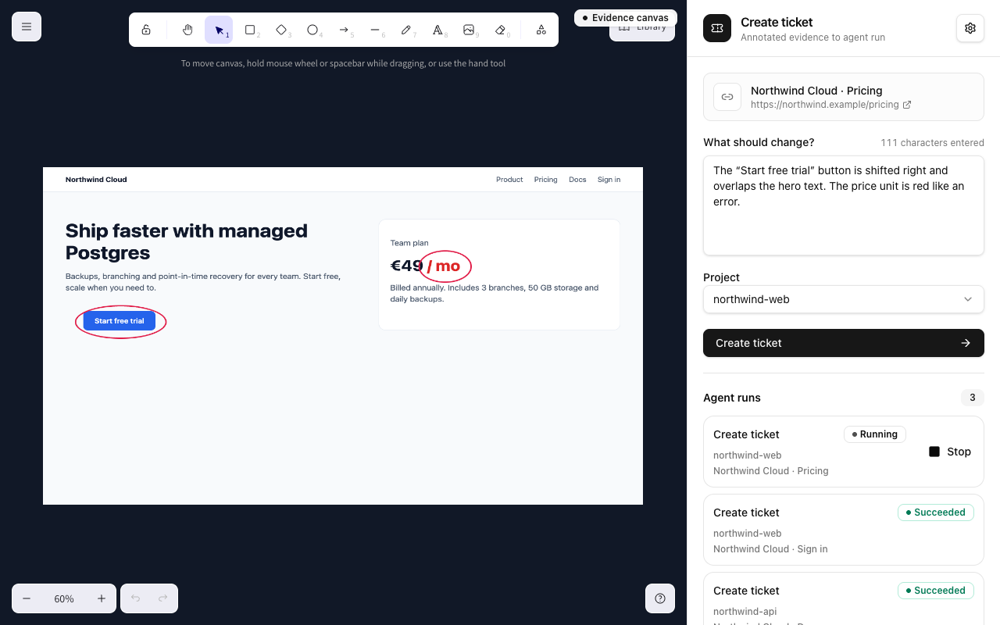

# Agent Ticket

Spot a bug on a web page, press **⌘⇧Y**, circle the problem and write one sentence. Agent Ticket hands the
annotated screenshot, the page address and your note to the coding agent you already use (Claude Code, Codex,
Jcode, Hermes or OpenCode), running in your project, and the agent files the ticket the way your project does it.

## Install

1. Install the extension. It is not in the Chrome Web Store or Firefox Add-ons yet. Download
   `agent-ticket-vX.Y.Z-chrome.zip` from the [latest release](https://github.com/clearlane/agent-ticket/releases/latest),
   unzip it, open `chrome://extensions`, enable **Developer mode**, click **Load unpacked** and pick the folder.
2. Open the extension and click **Download for macOS**, open the disk image, then **Install Agent Ticket** and
   choose a project folder. The background runtime starts automatically and at every login.
3. Have at least one supported coding agent CLI installed and signed in.

macOS 13 or later. The extension tells you when a runtime update is available.

Current installers are not yet Developer ID signed or notarized: the first time, right-click **Install Agent
Ticket** and choose **Open**.

## Privacy

Nothing leaves your machine except to the coding agent you chose. See [PRIVACY.md](PRIVACY.md).

## Support

Open an issue in this repository or write to contact@my-proof.com.

_This repository hosts releases and documentation. Source code is maintained privately by MYPROOF._
